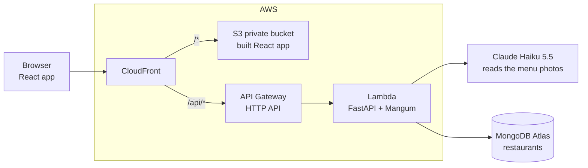

# Paper to QR

A restaurant manager photographs their paper or chalkboard menu and gets an editable digital menu, a code to come back with, and a printable QR code for the tables. No typing, no account.

Live: https://d1gdupqowt3o8k.cloudfront.net

Built for **Build With AI: Basics**, a Devpost learning hackathon. The planning documents (scope, product requirements, technical spec, build checklist) are in [`devpost/`](devpost/).

## How to test it (for judges)

Open https://d1gdupqowt3o8k.cloudfront.net, ideally on a computer with your phone at hand.

**Option 1: start from the demo menu (fastest)**

1. In the **Existing menu** tab (open by default), paste the code **`3TG-QSW`** and click **Validate**.
2. The Menu screen of the demo restaurant, *Chez Marcel*, opens with its dishes and prices.
3. Edit the menu: click the pencil to change a dish's name or price, then the check to save; add a dish with **Add dish**; delete one with the x; turn one inactive with the toggle.
4. See the customer side: scan the QR code with your phone, or click the link under the QR code. The page shows the restaurant name and the active dishes only, so a dish you turned inactive is gone and your edits are there.

The demo menu is shared by everyone who uses this code, so you may see changes made by other judges.

**Option 2: create your own menu from a photo**

1. Open the **New restaurant** tab, enter any restaurant name and add one or more photos of a menu. If you don't have one at hand, use the sample photos in [`sample-menu-photos/`](sample-menu-photos/):
   - [`breakfast-menu-letterboard.jpg`](sample-menu-photos/breakfast-menu-letterboard.jpg): a breakfast menu with sub-items and sides in two columns.
   - [`coffee-menu-letterboard.jpg`](sample-menu-photos/coffee-menu-letterboard.jpg): a coffee menu on a brick wall.

   Any other photo of a printed menu, a chalkboard or a letterboard works too.
2. Click **Read my menu**. After a few seconds, the dishes and prices read from the photo appear next to a QR code and a new code.
3. Compare the list with the photo, fix what was misread, then scan the QR code or click the link under it to see the customer page.
4. Keep the code: reload the home page, paste it in **Existing menu**, and your menu comes back.

Sample photos by [Nathan Dumlao](https://unsplash.com/@nate_dumlao) on Unsplash.

## The problem

Many restaurants, cafés and bistros still write their menu of the day in chalk or print it on paper. The menu changes often, and so do prices as ingredient costs rise: the old price gets crossed out and the new one written next to it. Existing digital menu tools ask the manager to create an account and retype the whole menu, which is exactly the friction that keeps them on paper.

Paper to QR removes both: one photo replaces the typing, and a short code replaces the account.

## What it does

### 1. Create a menu from photos

On the home page, the **New restaurant** tab asks for the restaurant name and one to five photos of the menu (drag and drop or file picker, phone camera included).

- Each photo is shown large and uncropped before submitting, so the manager can later compare the paper menu with the extracted list.
- Before upload, the browser shrinks every photo to 1600 px on its long edge and re-encodes it as JPEG. This keeps the request small and strips EXIF metadata such as GPS position.
- While the menu is processed, the screen shows the current step in plain words ("Uploading photos…", then "Reading your menu…") instead of a progress bar that would have to guess the duration. The switch between the two steps happens when the upload actually finishes.
- On the server, a single **Claude Haiku 5.5** call reads all the photos at once and returns the dishes with their prices as structured output. The prompt handles French price notations (`12,5`, `12€50`, `12 e 50`), keeps dish names as written (accents included), ignores section titles, dates and decorations, and merges dishes that appear on several photos. A dish whose price is unreadable is kept without a price.
- The photos stay in memory for this call only and are **never stored**.

A real chalkboard photo with 22 dishes was read in about 4.5 seconds on the deployed site.

### 2. Get a QR code and a code

As soon as the menu is read, the restaurant is saved and the **Menu screen** opens, with a "Menu ready" badge:

- **A QR code** pointing to the restaurant's public page (`/chez-marcel`), downloadable as a high-resolution PNG (`paper-to-qr-chez-marcel.png`) to print for the tables. It is drawn in the browser from the page address and never stored, so the same restaurant always gets the same QR code.
- **A six-character code** shown as `K7Q-29P`, copied in one click. It is the only key to edit the menu later. Its alphabet leaves out `0/O` and `1/I/L` so it can't be misread from a note.

The restaurant gets a URL slug built from its name (`Chez Marcel` becomes `chez-marcel`). Two restaurants with the same name get distinct slugs (`chez-marcel-2`), and names that would clash with the site's own paths are avoided.

### 3. Fix and update the dishes

The Menu screen lists every dish with its price, and the manager can correct whatever the extraction misread:

- **Edit in place:** the pencil turns the name and price into fields, and becomes a check to save. Escape or the x cancels the edit.
- **Delete:** the x opens a confirmation dialog, so a dish is never lost by mistake.
- **Add a dish** by hand, for example when the menu of the day changes.
- **Active / inactive toggle:** a dish that has run out stays in the manager's list (dimmed) but disappears from the customer page.

Prices can be typed as `12.50`, `12,5`, `12 €` or `12€50` and are stored in cents to avoid rounding errors. A dish needs a name to be saved. Every change is saved immediately.

If nothing could be read from the photos (blurry picture, timeout, API error), the restaurant, its code and its QR code are still created, and the manager is asked for a better photo or can type the menu with **Add dish**.

### 4. Come back the next day

The **Existing menu** tab, open by default since returning managers are the most frequent visitors, takes the code and opens the same Menu screen with the current dishes. The code is accepted in upper or lower case, with or without the dash. An unknown code shows "Restaurant not found" on the form.

### 5. The customer scans the QR code

On their phone, the customer lands on `/chez-marcel` and sees the restaurant name and the active dishes with their prices, nothing else. The page is mobile-first and never exposes the edit code. An empty menu shows "No dishes available right now", and an unknown address shows "Restaurant not found". Any change saved by the manager appears on the next reload.

## Design choices

- **No account by design.** Whoever has the code can edit the menu; anyone with the QR code can read it. A lost code can't be recovered, which is the trade-off of asking for no email or password.
- **The restaurant name can't be changed**, because the printed QR codes point to a URL built from it.
- **Privacy:** photos are never stored, EXIF data is removed before upload, and the edit code travels in an `X-Menu-Code` header rather than the URL, so it never shows up in CloudFront or API Gateway access logs.
- **Look and feel:** a "Pétrole" palette (blue-green with a touch of apricot used only for the "Menu ready" moment), Fraunces for headings and DM Sans for body text. The layout follows the Uxcel landing page found on Mobbin: a small logo, a headline, a short subtext and two buttons that switch tabs on the same page rather than navigating away. The interface avoids emoji and the usual generic AI-app styling.

## Architecture



- **Frontend** ([`frontend/`](frontend/)): React 19, Vite, TypeScript, Tailwind CSS 4 and shadcn/ui restyled with the project theme ([`frontend/src/styles/theme.css`](frontend/src/styles/theme.css)). Two routes: `/` (home and Menu screen) and `/:slug` (customer page). QR codes are drawn with `qrcode.react`.
- **API** ([`backend/`](backend/)): FastAPI running on AWS Lambda through Mangum.

  | Method | Route | Purpose |
  | --- | --- | --- |
  | `POST` | `/api/restaurants` | Create a restaurant from a name and 1 to 5 photos, run the extraction |
  | `GET` | `/api/manage` | Get the full menu for the code in `X-Menu-Code` |
  | `POST` | `/api/manage/dishes` | Add a dish |
  | `PATCH` | `/api/manage/dishes/{id}` | Change a dish's name, price or active state |
  | `DELETE` | `/api/manage/dishes/{id}` | Delete a dish |
  | `GET` | `/api/menus/{slug}` | Public menu: name and active dishes only |

- **Extraction** ([`backend/app/extraction.py`](backend/app/extraction.py)): one call per menu with structured outputs validated by Pydantic, low effort, and a 25-second timeout so a slow read still creates the restaurant within the Lambda's 29-second limit. Any failure returns an empty list instead of an error.
- **Data:** one MongoDB Atlas collection, `restaurants`, with unique indexes on `code` and `slug`. Each document holds the name, slug, code, dishes (`id`, `name`, `price_cents`, `active`) and timestamps.
- **Hosting** ([`template.yaml`](template.yaml), AWS SAM): one CloudFront distribution serves the app from a private S3 bucket (Origin Access Control) and routes `/api/*`, uncached, to the Lambda. A small CloudFront Function serves `index.html` for app routes like `/chez-marcel` without turning the API's 404 responses into HTML.
- **Tests** ([`backend/tests/`](backend/tests/)): 25 pytest tests covering code and slug generation, restaurant creation, lookups by code and slug, and every dish operation, using mongomock and a stubbed extraction.

## Run it locally

Requirements: Node 20+, Python 3.12, a MongoDB Atlas cluster (M0 is fine), an Anthropic API key.

```bash
cp backend/.env.example backend/.env   # then fill in ANTHROPIC_API_KEY, MONGODB_URI, MONGODB_DB=paper_to_qr

cd backend
python3.12 -m venv .venv
.venv/bin/pip install -r requirements.txt -r requirements-dev.txt
.venv/bin/uvicorn app.main:app --reload --port 8000

# in another terminal
cd frontend
npm install
npm run dev -- --host
```

Open http://localhost:5173. To scan the QR code with a phone on the same Wi-Fi, open the site from the Network address Vite prints: the QR code points to the address the page was opened from.

Tests: `cd backend && .venv/bin/python -m pytest`

## Deploy to AWS

Requires the AWS SAM CLI and AWS credentials. Atlas network access must allow `0.0.0.0/0`, since a Lambda outside a VPC has no fixed IP.

```bash
sam build
sam deploy --stack-name paper-to-qr --resolve-s3 --capabilities CAPABILITY_IAM \
  --parameter-overrides AnthropicApiKey=... MongoDbUri=... MongoDbName=paper_to_qr

cd frontend && npm run build
aws s3 sync dist s3://<FrontendBucketName> --delete
aws cloudfront create-invalidation --distribution-id <DistributionId> --paths "/*"
```

`FrontendBucketName`, `DistributionId` and `SiteUrl` are stack outputs. Cost stays near zero for a demo: pay-as-you-go CloudFront on the cheapest price class, an arm64 Lambda, and 7-day log retention.

## What's next

Out of scope for this proof of concept, possible later:

- Replacing or extending the menu with a new photo.
- Customizing the customer page (colors, restaurant logo).
- Categories, descriptions and allergens.
